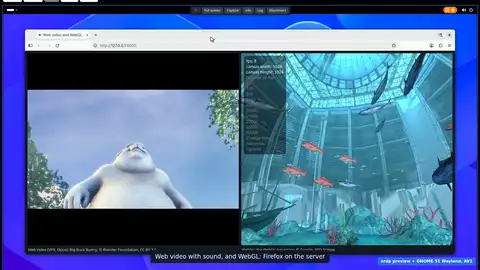
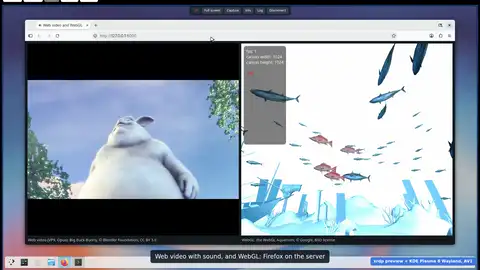
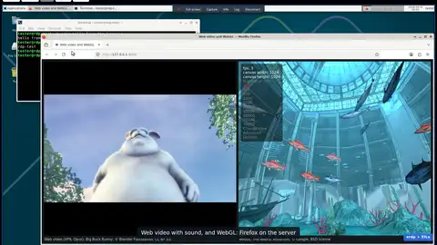
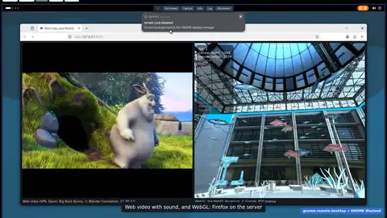

# FreeRDP Web

**Lightning-fast remote desktop in your browser:** AV1 decoded by the browser, multi-user
sessions with xrdp, no client to install.

A gift from a hobby to the world, for VDI, HPC, AI, VPS, research and the community: free and
open source under the Apache License 2.0.

**[Open the page](https://congzhangzh.github.io/freerdp-web/)** ·
[Demos](#demos) · [Safety](#safety) · [Release notes](CHANGELOG.md) ·
[Release kit](https://github.com/congzhangzh/rdp-release-kit)

## Demos

The xrdp preview with GNOME on Wayland, sent in AV1 and decoded by the browser (unmute for sound):

https://github.com/user-attachments/assets/cfed0bd1-1bf8-4614-9800-f35469f1d236

All four demos: each clip opens its video on the page, where it plays in full with sound. The
videos are recorded by the [release kit](https://github.com/congzhangzh/rdp-release-kit)'s CI:
a browser login to a throwaway server, then Firefox on the server with web video and WebGL.

<table>
<tr>
<td width="50%"><a href="https://congzhangzh.github.io/freerdp-web/#xrdp-gnome"></a><br>
<b>xrdp preview + GNOME Wayland, AV1</b><br>sesman starts a GNOME session per user; xrdp sends it in AV1 (4:4:4)</td>
<td width="50%"><a href="https://congzhangzh.github.io/freerdp-web/#xrdp-kde"></a><br>
<b>xrdp preview + KDE Plasma Wayland, AV1</b><br>KWin rendering in software, no GPU on the server</td>
</tr>
<tr>
<td width="50%"><a href="https://congzhangzh.github.io/freerdp-web/#xrdp-xfce"></a><br>
<b>xrdp + Xfce</b><br>xrdp on Debian 13, reached over SSH and websockify</td>
<td width="50%"><a href="https://congzhangzh.github.io/freerdp-web/#gnome-remote-desktop"></a><br>
<b>gnome-remote-desktop + GNOME Wayland</b><br>GNOME's own RDP server, headless</td>
</tr>
</table>

The links are the demos' lasting addresses (`media.json`'s `anchors`). The clips are 8-second
animated WebP cuts of the videos (480px, 10 fps, about 1.1 MB each), kept in
[`docs/media/`](docs/media). GitHub plays a video in a README only when it is uploaded to
GitHub itself (the `user-attachments` link above); a `<video>` tag is removed and other sites
are not allowed to serve media to the README. In the videos: Big Buck Bunny © Blender
Foundation, CC BY 3.0; WebGL Aquarium © Google, BSD.

## What it is

A web page that runs FreeRDP's SDL3 client, compiled to WebAssembly, to
connect to an RDP server from a browser. It needs a FreeRDP build with the
Emscripten client (upstream pull requests #13728, #13731, #13732 and
#13733 at the time of writing) and keeps saved hosts in a local, passkey
protected vault ([`web/VAULT.md`](web/VAULT.md)).

A browser cannot open TCP connections, so the page talks to the RDP server
through a WebSocket gateway, [websockify](https://github.com/novnc/websockify).

## How fast, measured

Where the browser has WebAssembly's JavaScript Promise Integration (JSPI, Chrome and Edge
137+), the page runs a build of the client made for it; other browsers get the Asyncify
build. Asyncify rewrites nearly every function so the stack can be unwound and rewound
around each wait; JSPI suspends inside the engine and leaves the code as compiled. The same
FreeRDP, linked both ways and nothing else different (headless Chrome 152, an xrdp session,
four sets of 6 to 12 runs per side):

| | Asyncify | JSPI | Change |
|---|---|---|---|
| Download, `sdl-freerdp.wasm` | 10.6 MB | 6.9 MB | −35 % |
| Connect (click → desktop's display channel up) | 511–567 ms | 359–384 ms | −29 to −33 % |
| Main-thread CPU, desktop idle | 2.7–4.2 % | 1.1–2.3 % | −45 to −65 % |
| Data received, xterm scrolling random text | 2230–2721 kB/s | 2543–2914 kB/s | 0 to +27 %, not claimed |

Every JSPI run connected sooner and idled lower than every Asyncify run of its set. The
method, the per-set numbers, and why the MessageChannel wake-up (9 to 16 µs per yield
against `setTimeout(0)`'s 4.1 ms, the one we chose) gains nothing yet are in [CHANGELOG.md, 20261025.1](CHANGELOG.md#202610251).

## The page

It runs at **https://congzhangzh.github.io/freerdp-web/**, published from this repository
only on purpose (*Run workflow* on a release tag, `<YYYYMMDD>.<N>`, with **publish**), after a login from the very files going live: [docs/hosting.md](docs/hosting.md).
The site is this repository's own; the [release kit](https://github.com/congzhangzh/rdp-release-kit)
pins this repository's releases (tags with a GitHub Release) for the client it builds.
Which browser features the page needs, and what stops working without each:
[docs/browsers.md](docs/browsers.md).

Open it, enter the gateway, user and password, and connect: the browser's password
manager keeps the password. The bar above the form keeps your hosts, each with its own
settings, and exports or imports them as a file (passwords only if you ask, encrypted with
a passphrase if you ask). **Session settings** choose sound, clipboard, the video codec
and a priority (save bandwidth, or reduce server load); **Advanced** holds Direct TCP for
the installed app, the passkey vault and free-form FreeRDP options. The help pages
(`safety.html`, `keyboard.html`, `install.html`) sit next to it.

Why it looks and behaves this way: [docs/webui-design.md](docs/webui-design.md). Where it
is published, and why only on purpose: [docs/hosting.md](docs/hosting.md).

## Safety

This is a hobby project, not written by security professionals. Keeping
your servers safe is up to you. The page's **Safety and tunnels** help
([`web/safety.html`](web/safety.html)) has the details; in short:

- **Never put RDP on the internet.** Let the RDP server listen on
  127.0.0.1 only (for xrdp: `port=tcp://.:3389` in `/etc/xrdp/xrdp.ini`)
  and reach it through SSH, which already handles keys, authentication and
  encryption.
- **Run the gateway only for the session.** While a gateway listens on
  127.0.0.1, any web page open in the same browser could connect to it.
  The RDP server still asks for its own credentials, but the gateway
  itself checks nothing.
- **Keep the gateway on 127.0.0.1**, on both ends.

### 1. Port → port: SSH and websockify together

With websockify on the server (Debian/Ubuntu: `apt install websockify`,
Fedora: `dnf install python3-websockify`), one ssh command does both, and
your computer needs nothing but ssh, which Windows 10/11, macOS and Linux
include:

```sh
ssh -tt -o ServerAliveInterval=30 -o ServerAliveCountMax=3 -o ExitOnForwardFailure=yes \
    -L 127.0.0.1:3390:127.0.0.1:3390 user@server websockify 127.0.0.1:3390 127.0.0.1:3389
```

Then open the page and connect with the gateway `127.0.0.1:3390` (the
default). Ctrl-C in the ssh window ends the gateway. Two details in that
line matter:

- `websockify 127.0.0.1:3390 …` listens on the server's loopback only;
  `websockify 3390 localhost:3389` would offer the bridge to the network.
- `-tt` always gives websockify a terminal (even when ssh has none), so it gets
  the hang-up signal and ends when the connection ends;
  without it, websockify keeps running on the server.
- `ServerAliveInterval=30` with `ServerAliveCountMax=3` ends a tunnel whose network died
  within about 90 seconds instead of leaving it hanging; `ExitOnForwardFailure=yes` makes
  ssh stop with an error when port 3390 is taken on your computer, instead of logging in
  without the forward.
- A server you cannot reach directly, only through another host: add `-J user@jumphost`.

When the page comes from a web site (for example GitHub Pages), Chrome asks
whether the site may access other apps and services on this device. Allow
it: that is how the page reaches the gateway on 127.0.0.1 (Chrome's Local
Network Access protection; it blocks the connection otherwise, with
`ERR_BLOCKED_BY_LOCAL_NETWORK_ACCESS_CHECKS` in the browser console).

[`rdp-gateway.sh`](rdp-gateway.sh) runs the same line:

```sh
./rdp-gateway.sh user@server            # RDP on the server's port 3389
./rdp-gateway.sh user@server 3390       # another RDP port
```

If websockify already runs on the server (on its 127.0.0.1:3390), a plain
forward is enough: `ssh -N -o ServerAliveInterval=30 -o ServerAliveCountMax=3 -o ExitOnForwardFailure=yes -L 127.0.0.1:3390:127.0.0.1:3390 user@server`.

<details>
<summary><b>Advanced: 2. port → socket, 3. socket → socket</b> (Unix sockets on the server)</summary>

Loopback keeps the network out, but not the server's other local users: any account on
that machine can reach 127.0.0.1:3389 and :3390. A Unix socket is a file with an owner and
a mode, so only the users it allows can open it. Your computer's side stays `127.0.0.1:3390`.

**Once, on the server**, for 2 and 3: xrdp moves from TCP to a socket in a setgid directory
of your group.

```sh
echo "d /run/xrdp-ws 2750 root $(id -gn) -" | sudo tee /etc/tmpfiles.d/xrdp-ws.conf
sudo systemd-tmpfiles --create /etc/tmpfiles.d/xrdp-ws.conf
sudo sed -i 's#^\( *\)port=\(tcp://[^ ]*:\)\{0,1\}3389 *$#\1port=unix://./run/xrdp-ws/xrdp.socket#' /etc/xrdp/xrdp.ini
sudo systemctl restart xrdp
```

**2. Port → socket**: websockify on 127.0.0.1:3390, xrdp on the socket. xrdp listens on no
TCP port; websockify still does while the tunnel runs (3 closes that).

```sh
ssh -tt -o ServerAliveInterval=30 -o ServerAliveCountMax=3 -o ExitOnForwardFailure=yes \
    -L 127.0.0.1:3390:127.0.0.1:3390 user@server websockify 127.0.0.1:3390 --unix-target=/run/xrdp-ws/xrdp.socket
```

**3. Socket → socket**: nothing listens but sshd. websockify's socket goes to
`/run/user/<ID>` (yours only); the first ssh fetches the ID, so it is never typed (bash or zsh):

```sh
S=user@server; R=$(ssh "$S" id -u) && ssh -tt -o ServerAliveInterval=30 -o ServerAliveCountMax=3 -o ExitOnForwardFailure=yes \
    -L 127.0.0.1:3390:/run/user/$R/rdp-ws.sock "$S" \
    websockify --unix-listen=/run/user/$R/rdp-ws.sock --unix-target=/run/xrdp-ws/xrdp.socket
```

The page's **Safety and tunnels** help has the details.

</details>

### Without websockify on the server

`./rdp-gateway.sh --local user@server` forwards the RDP port over SSH and
runs websockify on your computer (`pip install websockify`).

## Working on the page

The page needs no build: `site.sh` lays this checkout's `web/` over a client someone already
built, in a second or two.

```sh
./site.sh                                  # the release kit's newest tested client (cached)
./site.sh kit:<page commit>                # the client the kit built for that page commit
./site.sh ../rdp-release-kit/dist/wasm/web # a local build of the kit
python3 serve.py 8180 dist/site            # then open http://localhost:8180
node test-page.mjs dist/site               # or test it in Chrome
```

The kit's clients are its pre-releases `web-<YYYYMMDD>.<N>-<kit commit>` (titled with the page commit; `web-<page commit>-<kit commit>` before 21 October 2026), each built and tested
(a browser login to xrdp) before it is uploaded, and never replaced afterwards: a new build of
the same page is a new pre-release. [`kit-release.sh`](kit-release.sh) finds the newest one (or
the newest for a page commit); `site.sh` checks its SHA-256 and keeps it in
`~/.cache/freerdp-web`, with the splash's demo videos.

## Building

`build-wasm-vault.sh` builds the WebAssembly client for the page:

```sh
docker build -t freerdp-wasm-vault-toolchain -f Dockerfile.wasm-vault .
WASM_DEPS=<dependency prefix> bash build-wasm-vault.sh <FreeRDP source dir>
python3 serve.py 8180 dist
```

## Testing

| Test | Needs | Command |
|---|---|---|
| Unit tests: vault, connection bridge, session options, keyboard | Node 20+ | `node --test web/tests/*.test.cjs` |
| Reconnect against the CI xrdp session: a dropped gateway, then the toolbar's Reconnect | Node 22+, Chrome, `uvx websockify`, the `grd-wasm-xrdp-ci` container, a modular client served by `serve.py` | `PAGE=http://localhost:<port>/index.html node test-reconnect.mjs` |
| The page with the real client, no server | Node 22+, Chrome, a built client (`sdl-freerdp.js` and `.wasm`) | `node test-page.mjs <client dir>` |
| A full login: xrdp in a throwaway container, reached over SSH and websockify | Docker or Podman; the [release kit](https://github.com/congzhangzh/rdp-release-kit) with its Debian 13 xrdp packages built | `PAGE_SRC=<this checkout> ./build-wasm.sh`, then `test/wasm-session.sh dist/wasm/web <this checkout>/rdp-gateway.sh` in the kit |

`test-page.mjs` starts nothing that listens: Chrome answers the page's requests itself
(DevTools Fetch interception) with the headers the client's threads need, and the
connection goes to a port where nothing listens. Its screenshots and log go to `out/`.
The client directory can be the release kit's `dist/wasm/web` or an unpacked
`freerdp-web-*.zip` from its releases. Changes: [CHANGELOG.md](CHANGELOG.md).

## License

The page and its scripts are licensed under the Apache License 2.0: see
[LICENSE](LICENSE) and [NOTICE](NOTICE). The FreeRDP client it loads keeps its own licences.
